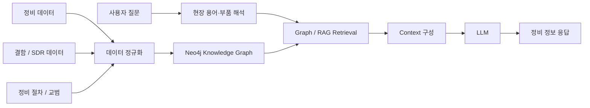

# AERON
### Neo4j Knowledge Graph · RAG 기반 항공정비 AI 지원 시스템

KT AIVLE School 빅프로젝트에서 수행한 **항공정비 정보 탐색 및 Physical AI 적용 프로젝트**입니다.

현직 항공정비사 인터뷰를 통해, 정비 작업 전 제한된 시간 안에 여러 매뉴얼과 과거 결함 사례를 찾아야 하는 문제를 확인했습니다.  
이를 해결하기 위해 항공정비 데이터를 **Neo4j Knowledge Graph**로 구조화하고, Graph 검색 결과와 정비 지식을 **RAG + LLM**으로 연결해 필요한 정보를 한 흐름에서 탐색할 수 있도록 구현했습니다.

프로젝트는 크게 두 축으로 구성됩니다.

```text
1. Knowledge AI
   항공정비 데이터 → Neo4j → RAG → LLM → 정비 정보 제공

2. Physical AI PoC
   결함 확인 → 검사 계획 → 이동·촬영 → 품질 확인 → 재촬영 / Human Handoff
```

> 핵심 목표: 흩어진 정비 정보를 단순 검색하는 것이 아니라  
> **결함·부품·정비절차·과거 사례의 관계를 연결해 정비 판단에 필요한 맥락을 제공하는 것**

---

## 1. Problem

항공정비 현장에서는 작업 배정 후 제한된 시간 안에 필요한 정보를 찾아 정비를 준비해야 합니다.

그러나 관련 정보가 매뉴얼, 결함 데이터, 부품 정보, 과거 사례 등 여러 자료에 분산되어 있어 다음과 같은 문제가 있었습니다.

```text
결함 확인
   ↓
관련 부품 확인
   ↓
매뉴얼 탐색
   ↓
과거 유사 사례 검색
   ↓
정비 절차 판단
```

각 단계에서 서로 다른 자료를 찾아야 하므로 정보 탐색 시간이 길어질 수 있습니다.

AERON은 이 정보를 하나의 지식구조로 연결하고, 사용자의 질문에 맞는 근거를 찾아 제공하도록 설계했습니다.

---

## 2. Solution



질문에서 부품과 정비 맥락을 파악하고, Neo4j에서 관련 결함·절차·근거를 조회해 LLM이 사용할 Context를 구성합니다.

LLM API가 없는 환경에서도 핵심 데모를 확인할 수 있도록 규칙 기반 fallback 구조를 함께 두었습니다.

---

## 3. Why Knowledge Graph?

항공정비 정보는 단순히 문서 내용이 비슷한지를 찾는 것만으로 충분하지 않습니다.

예를 들어 하나의 결함을 확인할 때도 다음 관계를 함께 이해해야 합니다.

```text
항공기 시스템
   ↓
부품
   ↓
결함
   ↓
정비 절차
   ↓
근거 문서
   ↓
과거 사례
```

따라서 의미 기반 검색과 함께 **데이터 간 관계를 탐색할 수 있는 GraphDB**가 필요하다고 판단해 Neo4j를 적용했습니다.

프로젝트에서는 FAA 분류체계, 결함 데이터, 정비 관련 정보를 기반으로 항공정비 지식구조를 구성했습니다.

---

## 4. RAG + LLM

`server.js`에서는 다음 흐름으로 자유 질문을 처리합니다.

```text
사용자 질문
   ↓
현장 용어 / 부품 해석
   ↓
Neo4j에서 관련 데이터 조회
   ↓
정비 절차·근거 Context 구성
   ↓
LLM 답변 생성
```

Neo4j 연결은 로컬 환경과 Neo4j Aura 환경을 모두 고려하도록 구성했으며, 환경변수로 연결 정보를 변경할 수 있습니다.

LLM Provider 역시 환경변수에 따라 선택할 수 있도록 구현했습니다.

- Gemini API
- Anthropic Claude API
- API Key 미설정 시 규칙 기반 fallback

이를 통해 LLM Provider가 변경되어도 전체 검색 구조를 크게 수정하지 않도록 분리했습니다.

---

## 5. 주요 기능

| 기능 | 설명 |
|---|---|
| 정비 지식 탐색 | 결함·부품·정비절차 등 관계 기반 조회 |
| Neo4j RAG | Graph 검색 결과를 LLM Context로 구성 |
| 자연어 질의 | 사용자의 정비 질문을 받아 관련 정보 제공 |
| Provider 분리 | Gemini / Claude 환경변수 기반 선택 |
| Fallback | LLM 사용이 어려운 환경에서는 규칙 기반 처리 |
| 관리자 화면 | 데모 및 업무 현황 확인을 위한 관리 기능 |
| Physical AI PoC | 검사 대상 인지·경로계획·촬영·품질판정·재계획 시뮬레이션 |

---

## 6. Physical AI PoC

AERON의 확장 PoC로 항공기 블레이드 검사 과정을 시뮬레이션했습니다.

미리 정해진 애니메이션을 재생하는 것이 아니라, 각 단계의 결과에 따라 다음 행동을 결정하도록 상태 기반으로 구성했습니다.

```text
TASK_RECEIVED
   ↓
PERCEIVING
   ↓
PLANNING
   ↓
NAVIGATING
   ↓
POSITIONING
   ↓
CAPTURING
   ↓
QUALITY_CHECK
   ├─ PASS → VERIFIED → NEXT_TARGET
   └─ FAIL
        ├─ 재시도 가능 → REPLANNING → RECAPTURE
        └─ 반복 실패 → HUMAN_HANDOFF
```

### 구현 요소

| 영역 | 구현 내용 |
|---|---|
| Perception | 블레이드 영역 검출 및 위치·yaw 추정 |
| Mobility | Occupancy Grid + A* 기반 이동 경로 계획 |
| Manipulation | 추정 Pose 기반 로봇 동작 |
| Quality Check | 촬영 Coverage 기준 PASS / FAIL |
| Closed-loop | 품질 미달 시 촬영 위치 재계산 및 재촬영 |
| HITL | 반복 실패 시 사람에게 판단 이관 |

최종 결함 판정은 자동화하지 않고 정비사가 수행하도록 두었으며, 로봇은 검사에 필요한 촬영과 품질 확인을 지원하는 역할로 제한했습니다.

---

## 7. Tech Stack

| 영역 | 기술 |
|---|---|
| Backend | Node.js |
| Knowledge Graph | Neo4j / Cypher |
| AI / RAG | Graph Retrieval + LLM |
| LLM | Gemini API / Anthropic Claude API |
| Frontend | HTML / JavaScript |
| Physical AI PoC | Python / PyBullet |
| Path Planning | A* |
| Data Loading | JavaScript / Cypher |

Node.js 실행 환경은 `18+`를 기준으로 합니다.

---

## 8. Repository Structure

```text
AERON/
├── server.js                  # Neo4j 조회 / RAG / LLM / Backend
├── package.json               # Node.js 실행 설정
│
├── index.html                 # 사용자 화면
├── login.html
├── manager.html               # 관리자 화면
│
├── d008_blade.cypher          # Blade 관련 Graph 데이터
├── d008_skin.cypher           # Skin 관련 Graph 데이터
├── load_sdr_blade.js          # SDR 데이터 적재
├── run_cypher.js              # Cypher 실행
│
├── sim_physical_ai.py         # Physical AI 시뮬레이션
├── verify_simulation.py       # 시뮬레이션 검증
├── print_execution_log.py     # 상태 전이 로그
├── make_mp4.py                # 렌더링 결과 영상 생성
├── resume_render.py           # 렌더 재개
└── verify_result.txt          # 검증 결과
```

---

## 9. Run — Knowledge AI

### Node.js

```bash
git clone https://github.com/rlaqhfla0917-bit/AERON.git
cd AERON
npm start
```

Node.js 18 이상이 필요합니다.

### Neo4j

로컬 Neo4j를 사용하는 경우 기본 연결을 사용할 수 있고, Neo4j Aura를 사용하는 경우 환경변수를 설정합니다.

```env
NEO4J_URI=
NEO4J_USER=
NEO4J_PW=
NEO4J_DATABASE=
```

LLM을 연결하려면 아래 중 사용할 Provider의 API Key를 설정합니다.

```env
GEMINI_API_KEY=
ANTHROPIC_API_KEY=
LLM_PROVIDER=
```

API Key가 없는 경우 일부 질의는 규칙 기반 fallback으로 처리됩니다.

---

## 10. Run — Physical AI PoC

Python 3.11 환경을 권장합니다.

```bash
pip install pybullet numpy pillow imageio-ffmpeg
```

3D 시뮬레이션 실행:

```bash
py -3.11 sim_physical_ai.py
```

프레임 렌더링:

```bash
py -3.11 sim_physical_ai.py --render
```

검증:

```bash
py -3.11 verify_simulation.py
```

실행 로그:

```bash
py -3.11 print_execution_log.py
```

---

## 11. Verification

Physical AI PoC는 렌더된 프레임을 기준으로 충돌 및 겹침 여부를 검증할 수 있도록 별도 검증 스크립트를 구성했습니다.

`verify_result.txt`에는 시뮬레이션 검증 결과가 저장됩니다.

검사 품질이 기준에 미달할 경우 단순 실패 처리하지 않고 **재촬영 → 재계획 → 필요 시 Human Handoff**로 이어지는 구조를 구현했습니다.

---

## 12. Project Role

**7인 팀 PM**

프로젝트에서 단순히 기능을 나누는 데 그치지 않고, 실제 정비사가 어떤 순서로 정보를 필요로 하는지를 기준으로 전체 서비스 흐름을 정리했습니다.

- 현직 항공정비사 VOC를 기반으로 문제 정의
- 프로젝트 기능 및 우선순위 정리
- 항공정비 데이터와 서비스 흐름 연결
- Neo4j Knowledge Graph / RAG 활용 방향 설계
- 팀 결과물을 하나의 정비 지원 서비스 흐름으로 통합

---

## 13. What I Learned

이 프로젝트를 통해 AI 서비스에서 중요한 것은 모델 자체만이 아니라 **산업 데이터를 어떤 구조로 연결하고, 사용자가 실제로 필요한 흐름으로 제공하느냐**라는 점을 배웠습니다.

특히 관계가 중요한 산업 데이터에서는 Vector Search만으로 모든 문제를 해결하기보다, **Knowledge Graph와 RAG를 함께 활용해 데이터의 관계와 근거를 보존하는 방식**이 효과적이라는 점을 확인했습니다.

또한 Physical AI PoC를 통해 AI의 판단 결과를 실제 행동으로 연결할 때는 **품질 확인, 재시도, Human Handoff와 같은 안전한 실행 흐름**이 필요하다는 점을 경험했습니다.

---

## Project Context

KT AIVLE School Big Project  
Aircraft Maintenance AI / Knowledge Graph / RAG / Physical AI PoC
