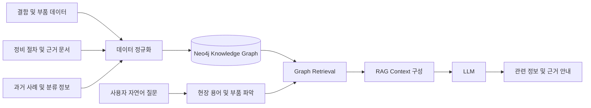

# AERON
### Neo4j Knowledge Graph · RAG 기반 항공정비 AI 지원 시스템

**KT AIVLE School 7인 팀 빅프로젝트**에서 현직 항공정비사 인터뷰를 바탕으로 설계한 정비 정보 탐색 서비스입니다.

작업 전 필요한 정보를 찾기 위해 매뉴얼, 결함 사례, 부품 정보 등을 각각 검색해야 하는 문제에 주목했습니다. 항공정비 데이터를 **Neo4j Knowledge Graph**로 구조화하고, 연결된 정보를 **RAG + LLM**의 응답 맥락으로 제공하도록 구현했습니다.

> **핵심 목표:** 흩어진 결함·부품·정비절차·과거 사례를 관계로 연결하여 정비사가 **근거를 확인하면서 관련 정보를 탐색**할 수 있도록 지원

**[웹 포트폴리오 데모 보기](https://rlaqhfla0917-bit.github.io/AERON/)** · 사전 구성된 가상 사례를 보여주는 **정적 시연 화면**입니다. 실제 Neo4j 및 LLM에 연결된 서비스는 아닙니다.

---


## Verification & Code Evidence

**구현 근거**
- [`server.js`](server.js): Neo4j HTTP Query API 질의, Graph 결과를 활용한 LLM 응답 및 규칙 기반 폴백
- [`run_cypher.js`](run_cypher.js): Cypher 파일 읽기, SQL과 구별되는 Graph 적재 실행 도구 (`--dry`로 DB 없이 구문 분리 내역 확인)
- [`load_sdr_blade.js`](load_sdr_blade.js): CSV 기반 외부 사례 데이터 적재 로직
- [정적 UI 시연](https://rlaqhfla0917-bit.github.io/AERON/): **사전 작성한 가상 사례**. 실제 Neo4j·LLM 연결 화면이 아님

**재현 가능한 검사**
1. `node --check server.js`, `node --check run_cypher.js`, `node --check load_sdr_blade.js`로 JavaScript 구문 검사
2. `node run_cypher.js d008_blade.cypher --dry`로 실행 대상 구문 확인 (**DB 변경 없음**)
3. [GitHub Actions](https://github.com/rlaqhfla0917-bit/AERON/actions)에서 위 JavaScript **구문 검사** 결과 확인

**검증 범위:** 자동 CI는 코드 구문과 미리보기 파일 존재를 확인할 뿐, 실제 Neo4j 질의 결과의 정합성·RAG 답변 정확도·검색시간 40% 단축을 입증하지 않습니다. 실서비스용 정비 판단 도구가 아니며 공식 교범과 전문가 검토가 필요합니다.

**본인 기여 구분:** 7인 팀 PM으로 인터뷰·문제 정의·우선순위·서비스 흐름·Graph/RAG 연계 설계와 결과물 통합을 주도했습니다. 이 저장소는 팀 프로젝트 결과물의 공유 코드이며 개별 파일 전체를 혼자 개발했다고 주장하지 않습니다.

---

## 1. Problem & Approach

항공정비 현장에서는 정비 작업에 앞서 여러 문서와 자료에서 필요한 정보를 찾아야 합니다. 현직 정비사 인터뷰를 통해 작업 배정 후 정보 검색에 시간이 소요된다는 문제를 확인했습니다.

다음과 같은 정보들을 독립적인 텍스트가 아닌 연결된 관계로 관리하도록 접근했습니다.

```text
항공기 시스템 → 부품 → 결함 → 정비 절차 → 근거 문서 → 과거 사례
```

정비 정보 **검색시간 40% 이상 단축은 프로젝트의 목표·기대효과**이며, 실사용 환경에서 측정된 성과라고 주장하지 않습니다.

## 2. Architecture



1. 정비 데이터를 공통 분류·부품·결함 기준으로 정규화합니다.
2. Neo4j에 노드 및 관계를 구성하여 서로 관련된 정보를 검색합니다.
3. 자연어 질문에서 부품과 질문 의도를 파악합니다.
4. 조회한 정비 절차·결함 사례 등의 맥락을 LLM 답변 생성에 제공합니다.
5. 관련 근거를 함께 확인할 수 있도록 정비 정보 탐색을 지원합니다.

## 3. Why Neo4j + RAG?

문서 의미만 비슷하다고 검색하는 것으로는 부품, 결함, 절차, 과거 사례 사이의 연결을 보존하기 어렵습니다.

- **Knowledge Graph:** 부품과 결함, 근거 문서의 관계 기반 탐색
- **RAG:** 검색된 정비 자료를 질문과 관련된 맥락으로 구성
- **LLM:** 자연어 질문에 대해 관련 정보를 이해하기 쉬운 형태로 안내
- **Fallback:** API 키가 없는 데모 환경에서 규칙 기반 응답 지원

LLM을 최종 정비 승인이나 결함 판정의 대체 수단으로 사용하지 않으며, 정비 판단에는 공식 교범 및 전문가 확인이 필요합니다.

## 4. Core Features

| 기능 | 구현 내용 |
|---|---|
| 정비 지식 탐색 | 결함·부품·정비절차 및 사례의 관계 기반 조회 |
| Neo4j / Cypher | 정비 지식과 근거의 구조화 및 관계 탐색 |
| Graph RAG | Graph 조회 결과를 LLM Context로 구성 |
| 자연어 질문 | 부품·현장 용어 및 질문 의도에 따른 탐색 |
| LLM Provider 분리 | Gemini / Claude 환경변수 기반 선택 |
| Fallback | 외부 LLM 호출이 어려운 환경에서 규칙 기반 응답 |
| 서비스 UI | 사용자 질의 화면 및 관리자 화면 제공 |

## 5. Tech Stack

| 분야 | 기술 |
|---|---|
| Backend | Node.js |
| Knowledge Graph | Neo4j, Cypher |
| AI / RAG | Graph Retrieval, LLM |
| LLM | Gemini API, Anthropic Claude API |
| Frontend | HTML, JavaScript |
| Data ingestion | JavaScript, Cypher |

## 6. Key Repository Files

```text
AERON/
├── server.js            # Node.js / Neo4j 조회 / RAG / LLM 백엔드
├── package.json         # 실행 설정
├── index.html           # 서비스 사용자 UI
├── login.html           # 로그인 UI
├── manager.html         # 관리자 UI
├── d008_blade.cypher    # Blade 정비 관련 Graph 데이터
├── d008_skin.cypher     # Skin 정비 관련 Graph 데이터
├── load_sdr_blade.js    # 사례 데이터 적재
├── run_cypher.js        # Cypher 실행 도구
└── docs/
    ├── index.html      # 공개 포트폴리오 웹 미리보기
    └── README.md
```

*위 목록은 지식 탐색 서비스의 주요 파일만 선별한 것입니다.*

## 7. Run Locally

Node.js 18 이상에서:

```bash
git clone https://github.com/rlaqhfla0917-bit/AERON.git
cd AERON
npm start
```

Neo4j 로컬 서버 또는 Aura 연결을 위해 다음 환경변수를 설정합니다.

```env
NEO4J_URI=
NEO4J_USER=
NEO4J_PW=
NEO4J_DATABASE=
```

LLM을 연동하려면 지원 Provider 중 하나의 키를 설정합니다.

```env
GEMINI_API_KEY=
ANTHROPIC_API_KEY=
LLM_PROVIDER=
```

실행 환경에 따라 DB·API 연결 및 데이터 적재가 필요하며, 공개 웹 미리보기에는 실제 데이터 연결이 포함되어 있지 않습니다.

## 8. My Role — 7인 팀 PM

- 현직 정비사 인터뷰를 통해 업무 문제와 탐색 흐름 정의
- 서비스 기능 우선순위와 전체 사용자 시나리오 설계
- 항공정비 데이터 및 Neo4j Knowledge Graph 활용 방향 기획
- Graph 검색 결과를 RAG로 연결하는 서비스 흐름 정리
- 팀원별 작업 조율 및 결과물 통합, 프로젝트 발표

## 9. What I Learned

AI 서비스를 실제 산업에 적용하려면 모델의 응답뿐 아니라 **입력 데이터의 구조, 검색 근거, 사용자에게 제공하는 정보의 맥락**을 함께 고려해야 한다는 점을 배웠습니다.

AERON에서는 관계가 중요한 정비 데이터를 단순 키워드 검색에 맡기지 않고 Knowledge Graph와 RAG를 결합해 사용자의 정보 탐색을 지원하는 방향을 설계했습니다.

---

**Project Context** · KT AIVLE School Big Project / Aircraft Maintenance Knowledge Graph / RAG
